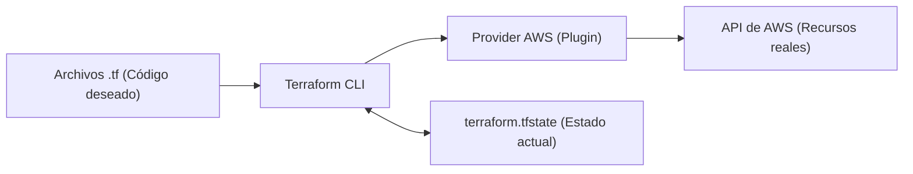
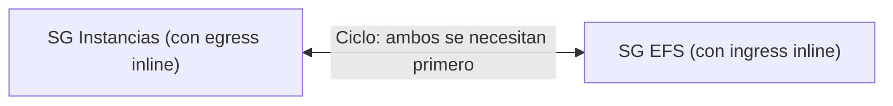
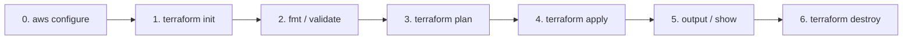
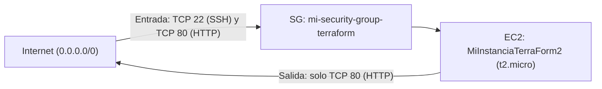
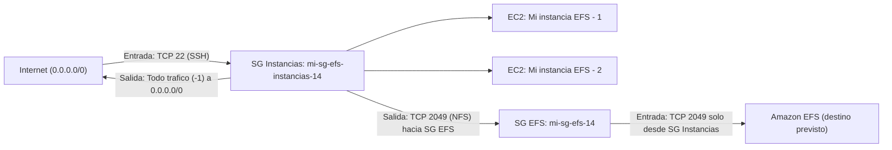

# Documentación de Infraestructura como Código con Terraform (AWS)

> **Documento sincronizado automáticamente** desde el cuaderno web [Computación Grid y Cloud](https://apuntes-grid-cloud.vercel.app/) mediante `node scripts/construir.mjs`.
> Para estudiar la versión web completa (con los 12 temas, flashcards, modo oscuro y diagramas ampliables), abre: **[https://apuntes-grid-cloud.vercel.app/](https://apuntes-grid-cloud.vercel.app/)**.

---

## Tabla de Contenidos

- [Parte I — Teoría, Anatomía HCL y Comandos (Tema 6)](#6-infraestructura-como-código-con-terraform)
- [Parte II — Talleres Prácticos: Taller 8 y Taller 12 (Tema 12)](#12-talleres-prácticos-de-terraform-ec2-y-efs)

---

## 6. Infraestructura como código con Terraform

**Terraform** es una herramienta de código abierto de **Infraestructura como Código (IaC)** creada por HashiCorp. Permite definir, crear, actualizar y eliminar (CRUD) recursos en la nube mediante archivos de configuración (extensión `.tf`, normalmente con `main.tf` como archivo principal) de manera **declarativa**: defines tus intenciones (el *estado deseado*), no el paso a paso manual.

---

### 1. ¿Cómo funciona internamente?

En lugar de entrar a la consola web de AWS y hacer clic para crear servidores o firewalls, escribes archivos `.tf` en lenguaje **HCL** (*HashiCorp Configuration Language*). Terraform se comunica con las APIs de AWS mediante un plugin llamado **Provider** y registra todo lo que crea en un **archivo de estado**.



#### Archivos especiales que genera Terraform

| Archivo / Carpeta | ¿Para qué sirve? | ¿Se sube a Git? |
| :--- | :--- | :--- |
| `main.tf` | Archivo principal con los recursos (`resource`) y el proveedor (`provider`). | **Sí** |
| `variables.tf` | Declara las **variables de entrada** (`variable`) para parametrizar el proyecto sin escribir valores fijos. *(Convención oficial en plural; Terraform lee cualquier `*.tf`, por eso `variable.tf` también funciona).* | **Sí** |
| `outputs.tf` | Declara las **salidas** (`output`) que se muestran en consola al desplegar y se exponen para otros módulos o scripts. | **Sí** |
| `terraform.tfvars` *(opcional)* | Asigna valores concretos a las variables definidas en `variables.tf` (por ejemplo, distintos valores para desarrollo vs. producción). | Depende (no si tiene secretos) |
| `.terraform/` | Carpeta oculta donde `terraform init` descarga el plugin del proveedor (ej. `hashicorp/aws`). | **No** |
| `.terraform.lock.hcl` | Archivo candado que fija la versión exacta del proveedor para despliegues reproducibles. | **Sí** (recomendado) |
| `terraform.tfstate` | **Archivo de estado.** Mapea tu código con los recursos reales en AWS (IDs, IPs, etc.). Permite saber qué actualizar o destruir. | **No** (puede contener datos sensibles) |
| `terraform.tfstate.backup` | Respaldo automático del estado inmediatamente anterior al último cambio. | **No** |

> **Regla clave de organización:** Terraform lee **todos los archivos `.tf`** de la carpeta como un solo bloque lógico. Separar en `main.tf`, `variables.tf` y `outputs.tf` no cambia la ejecución, pero mantiene el código limpio, reutilizable y fácil de mantener.

---

### 2. Anatomía del código HCL (Bloques fundamentales)

#### 2.1 Bloque `provider` (Proveedor)
Define **con qué nube o plataforma** se conecta Terraform y en qué región operará.

```hcl
provider "aws" {
  region = "us-east-1"
}
```

- `"aws"`: nombre del proveedor oficial de Amazon Web Services.
- `region`: región geográfica de despliegue (`us-east-1` = Norte de Virginia).

#### 2.2 Bloque `resource` (Recurso)
Es el bloque principal. Cada `resource` declara **un objeto real de infraestructura** en AWS (una instancia EC2, un Security Group, una regla de red, etc.).

```hcl
resource "<TIPO_DE_RECURSO>" "<NOMBRE_LOCAL>" {
  argumento_1 = "valor_1"
  argumento_2 = "valor_2"
}
```

Es clave distinguir **tres nombres distintos**:

1. **Tipo de recurso (`<TIPO_DE_RECURSO>`):** Definido por el proveedor AWS (no se puede inventar). Indica *qué servicio de AWS* se creará (`aws_instance`, `aws_security_group`, etc.).
2. **Nombre local (`<NOMBRE_LOCAL>`):** Lo eliges libremente. Solo existe **dentro de Terraform** para referenciar el recurso desde otros bloques (ej. `mi_instancia`, `mi-sg`).
3. **Nombre en AWS (`name` o `tags.Name`):** Es el argumento interno que define cómo aparecerá el recurso en la consola web de AWS.

##### Tipos de `resource` usados en los talleres de clase

| Tipo de recurso | Servicio AWS | ¿Para qué sirve? |
| :--- | :--- | :--- |
| `aws_security_group` | EC2 / VPC | Crea un firewall virtual que agrupa reglas de tráfico entrante y saliente. |
| `aws_vpc_security_group_ingress_rule` | EC2 / VPC | Crea una **regla de entrada** desacoplada y la vincula a un Security Group (práctica recomendada por AWS). |
| `aws_vpc_security_group_egress_rule` | EC2 / VPC | Crea una **regla de salida** desacoplada y la vincula a un Security Group. |
| `aws_instance` | EC2 | Aprovisiona una máquina virtual (instancia EC2) con AMI, tamaño, llave SSH y red. |

#### 2.3 Archivo `variables.tf` y bloque `variable` (Variables de entrada)
El archivo **`variables.tf`** centraliza los parámetros configurables del proyecto para evitar valores fijos (*hardcoded*) en `main.tf` y reutilizar la misma infraestructura cambiando solo datos (región, AMI, tipo de instancia, llave SSH o cantidad).

```hcl
variable "cantidad_instancias" {
  description = "Cantidad de instancias"
  type        = number
  default     = 2
}
```

| Campo | Obligatorio | ¿Para qué sirve? |
| :--- | :--- | :--- |
| `"nombre"` | Sí | Identificador de la variable. Se lee en el código como `var.<nombre>` (ej. `var.cantidad_instancias`). |
| `description` | No (recomendado) | Documenta qué valor representa la variable. |
| `type` | No (recomendado) | Restringe el tipo de dato: `string`, `number`, `bool`, `list(...)`, `map(...)`, etc. |
| `default` | No | Valor por defecto. Si se omite, Terraform lo pedirá por terminal al ejecutar `plan` o `apply`. |

**¿Cómo recibe sus valores una variable?** (de menor a mayor prioridad):
1. Valor `default` dentro de `variables.tf`.
2. Variables de entorno (`TF_VAR_<nombre>`).
3. Archivo `terraform.tfvars` (se carga automáticamente si existe).
4. Bandera en terminal: `terraform apply -var="cantidad_instancias=3"`.

#### 2.4 Archivo `outputs.tf` y bloque `output` (Salidas)
El archivo **`outputs.tf`** define qué valores generados por AWS quieres **imprimir en consola** al terminar `terraform apply` (o volver a consultar con `terraform output`), sin tener que buscarlos en la consola web. Además, permite **exponer esos datos** para que otros módulos de Terraform o scripts externos los consuman.

```hcl
output "ip_publica_instancias" {
  description = "Direcciones IP públicas de las instancias creadas"
  value       = aws_instance.mi_instancia-efs[*].public_ip
}
```

| Campo | Obligatorio | ¿Para qué sirve? |
| :--- | :--- | :--- |
| `"nombre"` | Sí | Nombre con el que se imprimirá la salida en terminal. |
| `description` | No | Explica qué información devuelve la salida. |
| `value` | Sí | Atributo o expresión de los recursos que se quiere mostrar. |
| `sensitive` | No | Si es `true`, oculta el valor en la consola (útil para contraseñas o tokens). |

#### 2.5 Expresiones y conceptos clave en HCL

- **Referencias y dependencias implícitas:** Al escribir `vpc_security_group_ids = [aws_security_group.mi-sg.id]`, Terraform detecta automáticamente que **primero debe crear el Security Group** y luego la instancia EC2, sin definir el orden a mano.
- **Meta-argumento `count` e interpolación `${...}`:** Con `count = var.cantidad_instancias`, Terraform crea *N* copias del recurso usando un índice `count.index` que inicia en `0`. Al escribir `"Mi instancia EFS - ${count.index + 1}"`, genera nombres numerados (`1`, `2`, ...).
- **Expresión *Splat* (`[*]`):** Cuando un recurso usa `count`, se convierte en una lista. La sintaxis `aws_instance.mi_instancia-efs[*].public_ip` recorre todas las instancias y extrae una lista con el atributo `public_ip` de cada una.
- **Funciones nativas (`length()`):** `length(aws_instance.mi_instancia-efs)` devuelve cuántos elementos fueron creados en esa lista de instancias.

#### 2.6 Dependencia lineal vs. Dependencia cíclica (`Error: Cycle`)

Internamente, Terraform construye un **grafo de dependencias** (DAG) para saber en qué orden crear y destruir recursos.

- **Dependencia lineal (normal):** El recurso `B` necesita un dato de `A`, pero `A` no necesita nada de `B` (`A -> B`).
  - *Ejemplo:* `aws_instance` usa `aws_security_group.mi-sg.id`. Terraform crea primero el Security Group y luego la instancia EC2.
- **Dependencia cíclica (error):** Dos o más recursos **se necesitan mutuamente para poder crearse** (`A <-> B`). Terraform no puede decidir cuál va primero y aborta con `Error: Cycle`.

##### ¿Dónde ocurre en nuestro contexto (Taller 12: EC2 + EFS)?

Ocurre cuando **dos Security Groups se referencian entre sí mediante reglas inline** (dentro de cada bloque `aws_security_group`):
1. `SG_Instancias` define un `egress` hacia `SG_EFS.id` (necesita que `SG_EFS` exista primero).
2. `SG_EFS` define un `ingress` desde `SG_Instancias.id` (necesita que `SG_Instancias` exista primero).



**Solución (aplicada en el Taller 12):** Crear primero ambos Security Groups **vacíos** (sin reglas *inline*) y después agregar las reglas como **recursos separados** (`aws_vpc_security_group_ingress_rule` y `aws_vpc_security_group_egress_rule`). Así ambos IDs ya existen cuando se crean las reglas y el ciclo desaparece.

> **Corrección importante sobre EC2 y Security Groups:** Crear una instancia EC2 que referencia un Security Group **NO es una dependencia cíclica**, sino una dependencia lineal (`SG -> EC2`): no hace falta crear la instancia sin SG y asociarlo después, porque el SG no depende de la instancia. La estrategia de «crear primero los recursos base vacíos y vincularlos después» aplica precisamente al caso de **dos Security Groups que se referencian mutuamente** (o si una regla del SG intentara leer la IP privada de la propia instancia que usa ese SG).

---

### 3. Guía de comandos en terminal (Ciclo de vida)

Todos los comandos de Terraform se ejecutan **dentro de la carpeta del proyecto** que contiene los archivos `.tf`.



1. **Configurar credenciales de AWS**
   ```bash
   aws configure
   ```
   - Guarda `AWS Access Key ID`, `AWS Secret Access Key`, región (`us-east-1`) y formato (`json`). En AWS Academy / Learner Lab recuerda incluir también el `aws_session_token` en `~/.aws/credentials`.

2. **Inicializar el proyecto (primera vez o al agregar proveedores)**
   ```bash
   terraform init
   ```
   - Descarga el plugin del proveedor AWS en `.terraform/` y crea `.terraform.lock.hcl`.

3. **Formatear y validar sintaxis (sin tocar AWS)**
   ```bash
   terraform fmt
   terraform validate
   ```
   - `fmt` indenta y ordena el código automáticamente; `validate` verifica que la sintaxis HCL y las referencias sean válidas.

4. **Previsualizar el plan de ejecución**
   ```bash
   terraform plan
   ```
   - Compara tus `.tf` contra `terraform.tfstate` y AWS. Símbolos del plan:
     - `+` (**create**): se creará un recurso nuevo.
     - `~` (**update in-place**): se modificará sin destruirlo.
     - `-` (**destroy**): se eliminará.
     - `-/+` (**replace**): se destruirá y recreará (ej. al cambiar la AMI de una EC2).

5. **Aplicar los cambios en AWS**
   ```bash
   terraform apply
   ```
   - Muestra el plan, pide confirmación (`yes`), crea los recursos en AWS, actualiza `terraform.tfstate` e imprime los `outputs`. (Con `-auto-approve` omite la confirmación manual).

6. **Inspeccionar el despliegue actual**
   ```bash
   terraform output
   terraform state list
   terraform show
   ```
   - `output` vuelve a mostrar las salidas (como IPs públicas); `state list` enumera los recursos gestionados; `show` muestra todos los atributos guardados en el estado.

7. **Destruir la infraestructura al terminar el laboratorio**
   ```bash
   terraform destroy
   ```
   - Elimina todos los recursos registrados en el estado respetando el orden inverso de dependencias. Es fundamental ejecutarlo al terminar cada práctica para evitar costos o consumo de créditos.

---

### Conceptos relacionados

- [Talleres prácticos de Terraform: Taller 8 (EC2) y Taller 12 (EC2 + SG EFS)](https://apuntes-grid-cloud.vercel.app/#12-talleres-terraform).
- [Redes y seguridad: VPC y Security Groups](https://apuntes-grid-cloud.vercel.app/#03-redes-seguridad).
- [Consola, AWS CLI y SDK](https://apuntes-grid-cloud.vercel.app/#05-herramientas-aws).

---

## 12. Talleres prácticos de Terraform (EC2 y EFS)

Análisis práctico del repositorio de código [Aryy234/cloud-u1-ps-ae](https://github.com/Aryy234/cloud-u1-ps-ae), mostrando la evolución real entre **`taller8-ae2`** (despliegue básico en un solo archivo) y **`taller12-efs-ae`** (arquitectura modular con variables, outputs, `count` y reglas de red entre Security Groups para Amazon EFS).

> Si necesitas repasar qué son `provider`, `resource`, `variable`, `output` o los comandos de terminal, consulta primero el tema [6. Infraestructura como código con Terraform](https://apuntes-grid-cloud.vercel.app/#06-terraform).

---

### 1. Taller 8 (`taller8-ae2`): EC2 y Security Group básico

**Archivo:** `taller8-ae2/main.tf`
**Objetivo:** Primer despliegue en AWS con Terraform creando 1 instancia EC2 y 1 Security Group con reglas embebidas (*inline*) y valores fijos.



#### A. Recurso `aws_security_group` — Nombre local: `mi-sg`

| Campo | Valor en el proyecto | ¿Para qué sirve? |
| :--- | :--- | :--- |
| `name` | `"mi-security-group-terraform"` | Nombre visible del Security Group en la consola de AWS. |
| `description` | `"grupo de seguridad para mi terraform"` | Descripción del propósito del grupo. |
| `vpc_id` | `"vpc-09ffffa328714b7dd"` | ID de la VPC donde se crea el Security Group. |
| `ingress` (SSH) | `from_port = 22`, `to_port = 22`, `protocol = "tcp"`, `cidr_blocks = ["0.0.0.0/0"]` | Permite conexiones SSH entrantes desde cualquier dirección IPv4. |
| `ingress` (HTTP) | `from_port = 80`, `to_port = 80`, `protocol = "tcp"`, `cidr_blocks = ["0.0.0.0/0"]` | Permite tráfico web HTTP entrante desde cualquier IPv4. |
| `egress` (HTTP) | `from_port = 80`, `to_port = 80`, `protocol = "tcp"`, `cidr_blocks = ["0.0.0.0/0"]` | Permite tráfico saliente únicamente por el puerto 80 TCP. |

> **Observación técnica (`egress` en Taller 8):** Al permitir salida solo por el puerto `80`, la instancia no podría resolver DNS (puerto `53`) ni descargar paquetes por HTTPS (puerto `443`). En Terraform, a diferencia de la consola de AWS, no se crea automáticamente la regla de "toda salida" cuando defines `egress` manualmente. Esto se corrige en el Taller 12.

#### B. Recurso `aws_instance` — Nombre local: `mi_instancia`

| Campo | Valor en el proyecto | ¿Para qué sirve? |
| :--- | :--- | :--- |
| `ami` | `"ami-0c230065b91270bc6"` | Imagen del sistema operativo (AMI) que usará el servidor. |
| `instance_type` | `"t2.micro"` | Capacidad de hardware virtual (vCPU y RAM). |
| `key_name` | `"mi-primera-llaves-ae"` | Nombre del par de llaves SSH registrado en AWS para iniciar sesión. |
| `tags` | `{ Name = "MiInstanciaTerraForm2" }` | Etiqueta que asigna el nombre visible de la instancia en EC2. |
| `vpc_security_group_ids` | `[aws_security_group.mi-sg.id]` | Vincula el Security Group mediante una **referencia dinámica** (dependencia implícita). |

---

### 2. Taller 12 (`taller12-efs-ae`): Múltiples EC2 y red para Amazon EFS

**Archivos:** `taller12-efs-ae/main.tf`, `variable.tf` y `outputs.tf`
**Objetivo:** Aplicar buenas prácticas separando archivos, parametrizando con variables, desplegando 2 instancias con `count`, devolviendo outputs y configurando dos Security Groups comunicados por el puerto NFS `2049`.

> **Alcance actual del código:** `taller12-efs-ae` crea los Security Groups (para EC2 y para EFS) y las 2 instancias EC2, pero todavía no declara el recurso de almacenamiento EFS (`aws_efs_file_system` ni `aws_efs_mount_target`). Si el EFS se crea aparte en consola AWS, se asocia al Security Group `mi-security-group-terraform-efs` generado aquí.



#### A. Archivo `variable.tf` (Parámetros de entrada)

| Variable | Tipo (`type`) | Valor por defecto (`default`) | Uso en `main.tf` |
| :--- | :--- | :--- | :--- |
| `region` | `string` | `"us-east-1"` | `provider "aws"` (`region`) |
| `ami_id` | `string` | `"ami-0c230065b91270bc6"` | `aws_instance` (`ami`) |
| `tipo_instancia` | `string` | `"t2.micro"` | `aws_instance` (`instance_type`) |
| `nombre_llave` | `string` | `"mi-primera-llaves-ae"` | `aws_instance` (`key_name`) |
| `cantidad_instancias` | `number` | `2` | `aws_instance` (`count`) |

#### B. Archivo `main.tf` (Security Groups, Reglas e Instancias)

##### 1. Security Groups base (sin reglas *inline*)
- **`aws_security_group.mi-sg-efs-instancias-14`** (`name = "mi-security-group-terraform-efs-instancias"`): protege las instancias EC2 dentro de `vpc-09ffffa328714b7dd`.
- **`aws_security_group.mi-sg-efs-14`** (`name = "mi-security-group-terraform-efs"`): protege los *Mount Targets* de EFS en la misma VPC.

##### 2. Reglas independientes (`aws_vpc_security_group_*_rule`)

| Recurso | Tipo | Configuración y propósito |
| :--- | :--- | :--- |
| `entrada_ssh_instancias` | `ingress_rule` | Asociada al SG de instancias. Abre `tcp` puerto `22` desde `cidr_ipv4 = "0.0.0.0/0"` para acceso SSH. |
| `salida_efs` | `egress_rule` | Asociada al SG de instancias. Permite salida `tcp` puerto `2049` (NFS) cuyo destino es `referenced_security_group_id = aws_security_group.mi-sg-efs-14.id`. |
| `salida_internet` | `egress_rule` | Asociada al SG de instancias. Permite salida libre a Internet (`ip_protocol = "-1"`, todos los protocolos y puertos, hacia `0.0.0.0/0`) para instalar `amazon-efs-utils` y actualizaciones. |
| `entrada_efs` | `ingress_rule` | Asociada al SG de EFS. Permite entrada `tcp` puerto `2049` **únicamente** desde recursos que pertenezcan al SG de instancias (`referenced_security_group_id = aws_security_group.mi-sg-efs-instancias-14.id`). |

> **¿Por qué el SG de EFS no necesita reglas de salida?** Porque los Security Groups de AWS son **stateful**: al autorizar la entrada desde las EC2 por el puerto `2049`, el tráfico de respuesta queda permitido automáticamente.
>
> **¿Por qué separar las reglas en recursos independientes?** Además de seguir la buena práctica de AWS, **evita una dependencia cíclica (`Error: Cycle`)**: si `mi-sg-efs-instancias-14` y `mi-sg-efs-14` tuvieran reglas *inline* apuntándose mutuamente, Terraform no sabría cuál crear primero. Creándolos vacíos y añadiendo las reglas aparte se rompe el ciclo (ver [Tema 6 — Dependencia cíclica](https://apuntes-grid-cloud.vercel.app/#06-terraform)).

##### 3. Instancias EC2 (`aws_instance.mi_instancia-efs`)

| Campo | Valor en el proyecto | ¿Para qué sirve? |
| :--- | :--- | :--- |
| `ami` | `var.ami_id` | Sistema operativo parametrizado. |
| `instance_type` | `var.tipo_instancia` | Tipo de servidor parametrizado (`t2.micro`). |
| `key_name` | `var.nombre_llave` | Llave SSH parametrizada. |
| `count` | `var.cantidad_instancias` | Crea `2` instancias idénticas con índices `0` y `1`. |
| `tags` | `{ Name = "Mi instancia EFS - ${count.index + 1}" }` | Interpola el índice para nombrarlas `Mi instancia EFS - 1` y `Mi instancia EFS - 2`. |
| `vpc_security_group_ids` | `[aws_security_group.mi-sg-efs-instancias-14.id]` | Asigna el Security Group de instancias a cada máquina. |

#### C. Archivo `outputs.tf` (Salidas en terminal)

| Output | Expresión (`value`) | Resultado devuelto |
| :--- | :--- | :--- |
| `ids_instancias` | `aws_instance.mi_instancia-efs[*].id` | Lista con los IDs de todas las instancias creadas. |
| `cantidad_instancias` | `length(aws_instance.mi_instancia-efs)` | Total numérico de instancias (`2`). |
| `ip_publica_instancias` | `aws_instance.mi_instancia-efs[*].public_ip` | Lista con las IPs públicas para conectarte por SSH. |
| `zona_disponibilidad` | `aws_instance.mi_instancia-efs[*].availability_zone` | Lista con la zona de disponibilidad (AZ) de cada instancia. |

---

### 3. Comparativa Evolutiva: Taller 8 vs. Taller 12

| Aspecto | Taller 8 (`taller8-ae2`) | Taller 12 (`taller12-efs-ae`) | Mejora lograda |
| :--- | :--- | :--- | :--- |
| **Organización** | Todo en `main.tf` | `main.tf`, `variable.tf`, `outputs.tf` | Separación clara de responsabilidades. |
| **Parametrización** | Valores fijos (*hardcoded*) | Variables tipadas con valores `default` | Reutilización sin modificar `main.tf`. |
| **Reglas de SG** | Bloques *inline* `ingress`/`egress` | Recursos `aws_vpc_security_group_*_rule` | Evita recreaciones accidentales y sigue el estándar actual de AWS. |
| **Seguridad entre servicios** | Solo CIDR `0.0.0.0/0` | Referencia entre Security Groups (`referenced_security_group_id`) | Principio de mínimo privilegio entre EC2 y EFS. |
| **Salida a Internet** | Limitada al puerto 80 TCP | Todo el tráfico (`ip_protocol = "-1"`) | Permite DNS, HTTPS e instalación de paquetes. |
| **Escalabilidad** | 1 instancia fija | Múltiples instancias con `count` y `${count.index + 1}` | Escalar consiste en cambiar un número. |
| **Visibilidad** | Sin `outputs` | 4 `outputs` con `[*]` y `length()` | IPs y metadatos directos en terminal. |

---

### 4. Buenas prácticas y mejoras pendientes del repositorio

1. **No versionar archivos sensibles en Git:**
   - Nunca subir archivos `.pem` (llaves privadas) ni `terraform.tfstate` / `terraform.tfstate.backup` a GitHub.
   - Si ya fueron rastreados antes de actualizar `.gitignore`, se retiran del índice sin borrarlos localmente con:
     ```bash
     git rm --cached taller12-efs-ae/terraform.tfstate taller12-efs-ae/terraform.tfstate.backup
     git rm --cached mi-primera-llaves-ae.pem
     ```
2. **Parametrizar `vpc_id` y convención de nombres:**
   - Mover `vpc_id = "vpc-09ffffa328714b7dd"` a una variable (o consultar la VPC por defecto con `data "aws_vpc" "default" { default = true }`).
   - Por convención estándar de Terraform, el archivo de variables suele nombrarse en plural (`variables.tf`).
3. **Seguridad SSH en producción:**
   - En laboratorios se suele abrir SSH a `0.0.0.0/0`, pero en entornos reales debe restringirse a tu IP pública (`<TU_IP>/32`) o usar AWS Systems Manager Session Manager.
4. **Nota sobre `salida_efs` vs. `salida_internet`:**
   - Como `salida_internet` permite `ip_protocol = "-1"` hacia `0.0.0.0/0`, ya cubre el tráfico saliente al puerto `2049`. Conservar `salida_efs` es útil a nivel didáctico y protege la arquitectura si luego restringes la salida a Internet.
5. **Siguiente paso lógico en Terraform para EFS:**
   - Declarar `aws_efs_file_system` y `aws_efs_mount_target` (asociándole `aws_security_group.mi-sg-efs-14.id`) para automatizar también el sistema de archivos sin pasar por la consola web.

---

### Conceptos relacionados

- [6. Infraestructura como código con Terraform (teoría y comandos)](https://apuntes-grid-cloud.vercel.app/#06-terraform).
- [3. Redes y seguridad: VPC y Security Groups](https://apuntes-grid-cloud.vercel.app/#03-redes-seguridad).
- [9. Taller de almacenamiento EBS y EFS (montaje Linux paso a paso)](https://apuntes-grid-cloud.vercel.app/#09-taller-ebs-efs).
- [Repositorio de código en GitHub (cloud-u1-ps-ae)](https://github.com/Aryy234/cloud-u1-ps-ae).
