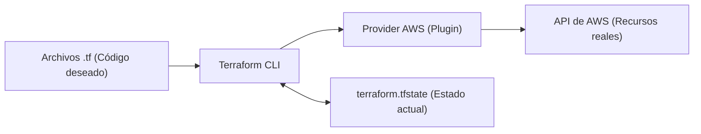
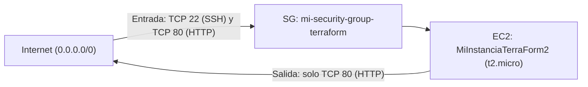
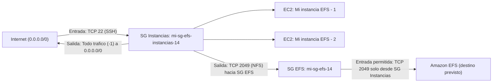
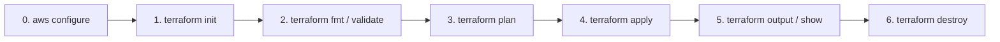

# Documentación de Infraestructura como Código con Terraform (AWS)

Guía completa y didáctica para comprender el código, la arquitectura, los conceptos de Terraform y el flujo de trabajo en terminal de los proyectos **`taller8-ae2`** y **`taller12-efs-ae`**.

---

## Tabla de Contenidos

1. [Fundamentos de Terraform e Infraestructura como Código (IaC)](#1-fundamentos-de-terraform-e-infraestructura-como-código-iac)
2. [Anatomía del código HCL (Bloques y Conceptos Clave)](#2-anatomía-del-código-hcl-bloques-y-conceptos-clave)
3. [Análisis del Taller 8 (`taller8-ae2`)](#3-análisis-del-taller-8-taller8-ae2)
4. [Análisis del Taller 12 (`taller12-efs-ae`)](#4-análisis-del-taller-12-taller12-efs-ae)
5. [Comparativa Evolutiva: Taller 8 vs. Taller 12](#5-comparativa-evolutiva-taller-8-vs-taller-12)
6. [Guía de Comandos en Terminal](#6-guía-de-comandos-en-terminal)
7. [Buenas Prácticas y Oportunidades de Mejora](#7-buenas-prácticas-y-oportunidades-de-mejora)

---

## 1. Fundamentos de Terraform e Infraestructura como Código (IaC)

### ¿Qué es Terraform?
**Terraform** es una herramienta de **Infraestructura como Código (IaC)** creada por HashiCorp. En lugar de entrar manualmente a la consola web de AWS y hacer clic para crear servidores (EC2) o firewalls (Security Groups), describes en archivos de texto (`.tf`) **qué infraestructura deseas tener**, y Terraform se encarga de crearla, modificarla o destruirla automáticamente usando las APIs de AWS.

Terraform es **declarativo**: tú defines el *estado deseado* (por ejemplo, "quiero 2 instancias `t2.micro`") y Terraform calcula qué acciones ejecutar para alcanzar ese estado.

### ¿Cómo funciona internamente?



### Archivos especiales que genera Terraform
Cuando ejecutas Terraform en una carpeta de proyecto, aparecen archivos y carpetas clave:

| Archivo / Carpeta | ¿Para qué sirve? | ¿Se sube a Git? |
| :--- | :--- | :--- |
| `*.tf` (`main.tf`, `variable.tf`, `outputs.tf`) | Tu código fuente escrito en lenguaje **HCL** (*HashiCorp Configuration Language*). Terraform lee **todos** los `.tf` de la carpeta como si fueran un solo programa. | **Sí** |
| `.terraform/` | Carpeta oculta donde `terraform init` descarga el plugin del proveedor (ej. `hashicorp/aws`). | **No** |
| `.terraform.lock.hcl` | Archivo candado que fija la versión exacta del proveedor descargado para garantizar despliegues reproducibles. | **Sí** (recomendado) |
| `terraform.tfstate` | **El archivo de estado**. Guarda el mapeo entre tu código y los recursos reales creados en AWS (IDs, IPs, etc.). Sin él, Terraform no sabría qué creó ni qué debe destruir. | **No** (puede contener datos sensibles) |
| `terraform.tfstate.backup` | Copia de seguridad automática del estado anterior antes del último cambio. | **No** |

---

## 2. Anatomía del código HCL (Bloques y Conceptos Clave)

Todo proyecto de Terraform se construye combinando **bloques**. A continuación se explican todos los bloques y expresiones que aparecen en tus talleres.

### 2.1 Bloque `provider` (Proveedor)
Le indica a Terraform **con qué plataforma o nube** se va a comunicar y en qué región trabajará.

```hcl
provider "aws" {
  region = "us-east-1"
}
```
- `"aws"`: nombre del plugin proveedor (Amazon Web Services).
- `region`: región geográfica de AWS donde se crearán los recursos (`us-east-1` corresponde a Norte de Virginia).

---

### 2.2 Bloque `resource` (Recurso)
Es el bloque más importante de Terraform. Cada bloque `resource` representa **un objeto real de infraestructura** en AWS (una máquina virtual, un grupo de seguridad, una regla de firewall, etc.).

#### Sintaxis general
```hcl
resource "<TIPO_DE_RECURSO>" "<NOMBRE_LOCAL>" {
  argumento_1 = "valor_1"
  argumento_2 = "valor_2"
}
```

Es fundamental distinguir estos **tres nombres distintos**:
1. **Tipo de recurso (`<TIPO_DE_RECURSO>`)**: Lo define el proveedor AWS y **no se puede inventar**. Indica *qué servicio de AWS* se va a crear (ejemplo: `aws_instance`, `aws_security_group`).
2. **Nombre local (`<NOMBRE_LOCAL>`)**: Lo eliges tú libremente. Solo existe **dentro de Terraform** para identificar ese bloque y referenciarlo desde otros recursos (ejemplo: `mi_instancia`, `mi-sg`). Debe ser único para el mismo tipo de recurso dentro de la carpeta.
3. **Nombre en AWS (`name` o `tags.Name`)**: Es el argumento interno que define cómo verás el recurso en la consola web de AWS.

#### Tipos de `resource` utilizados en tus talleres

| Tipo de recurso | Servicio AWS | ¿Para qué sirve? | Taller |
| :--- | :--- | :--- | :--- |
| `aws_security_group` | EC2 / VPC | Crea un **firewall virtual** que controla el tráfico de red entrante y saliente de los recursos asociados. | Taller 8 y Taller 12 |
| `aws_vpc_security_group_ingress_rule` | EC2 / VPC | Crea una **regla de entrada** independiente y la vincula a un Security Group (enfoque moderno recomendado por AWS). | Taller 12 |
| `aws_vpc_security_group_egress_rule` | EC2 / VPC | Crea una **regla de salida** independiente y la vincula a un Security Group. | Taller 12 |
| `aws_instance` | EC2 | Aprovisiona una **máquina virtual (instancia EC2)** en AWS con un sistema operativo (AMI), tamaño y llave SSH. | Taller 8 y Taller 12 |

---

### 2.3 Bloque `variable` (Variables de entrada)
Permite **parametrizar** el código para no escribir valores fijos (*hardcoded*) directamente en `main.tf`. Así puedes reutilizar la misma plantilla cambiando solo los valores (región, cantidad de servidores, tipo de instancia, etc.).

#### Sintaxis general
```hcl
variable "cantidad_instancias" {
  description = "Cantidad de instancias"
  type        = number
  default     = 2
}
```

| Campo | Obligatorio | ¿Para qué sirve? |
| :--- | :--- | :--- |
| `"nombre"` | Sí | Identificador de la variable. Se invoca en el código usando `var.<nombre>` (ej. `var.cantidad_instancias`). |
| `description` | No (recomendado) | Documenta qué representa la variable. |
| `type` | No (recomendado) | Valida el tipo de dato permitido: `string` (texto), `number` (número), `bool` (`true`/`false`), `list(...)`, `map(...)`, etc. |
| `default` | No | Valor por defecto si el usuario no proporciona otro. Si se omite, Terraform pedirá el valor por terminal al ejecutar `plan` o `apply`. |

> **Tip:** Puedes cambiar el valor de una variable sin editar el código ejecutando:
> `terraform apply -var="cantidad_instancias=3"`

---

### 2.4 Bloque `output` (Salidas)
Sirve para **imprimir y exponer información útil** en la terminal al finalizar `terraform apply` (como IPs públicas, IDs de instancias o zonas de disponibilidad) sin tener que entrar a la consola de AWS a buscarlos.

#### Sintaxis general
```hcl
output "ip_publica_instancias" {
  description = "Direcciones IP públicas de las instancias creadas"
  value       = aws_instance.mi_instancia-efs[*].public_ip
}
```

| Campo | Obligatorio | ¿Para qué sirve? |
| :--- | :--- | :--- |
| `"nombre"` | Sí | Etiqueta con la que se mostrará el resultado en la terminal. |
| `description` | No | Explica qué dato devuelve la salida. |
| `value` | Sí | Expresión o atributo de un recurso cuyo valor se desea mostrar. |

---

### 2.5 Conceptos clave usados en tu código

1. **Referencias y dependencias implícitas:**
   Cuando escribes `vpc_security_group_ids = [aws_security_group.mi-sg.id]`, estás leyendo el atributo `.id` que AWS genera al crear el Security Group. Automáticamente, Terraform entiende que **primero debe crear el Security Group y después la instancia EC2**, sin necesidad de indicarle el orden manualmente.
2. **Meta-argumento `count` e interpolación `${...}`:**
   En el Taller 12, `count = var.cantidad_instancias` le dice a Terraform que cree *N* copias del mismo recurso (en tu caso, 2). Cada copia recibe un índice numérico `count.index` que empieza en `0` (`0`, `1`, ...). Al escribir `"Mi instancia EFS - ${count.index + 1}"`, Terraform evalúa la expresión dentro de `${}` y nombra las instancias como `Mi instancia EFS - 1` y `Mi instancia EFS - 2`.
3. **Expresión *Splat* (`[*]`):**
   Cuando un recurso usa `count`, pasa a ser una **lista** de recursos. En `outputs.tf`, escribir `aws_instance.mi_instancia-efs[*].public_ip` recorre todas las instancias de esa lista y extrae una lista con el atributo `public_ip` de cada una.
4. **Funciones nativas (`length()`):**
   Terraform incluye funciones integradas. `length(aws_instance.mi_instancia-efs)` devuelve el número total de elementos en la lista de instancias creadas.

---

## 3. Análisis del Taller 8 (`taller8-ae2`)

**Ubicación:** `taller8-ae2/main.tf`
**Objetivo:** Desplegar una única instancia EC2 en AWS protegida por un Security Group básico con reglas de acceso SSH y HTTP, todo centralizado en un solo archivo.

### Arquitectura desplegada



---

### 3.1 Proveedor (`provider "aws"`)
- `region = "us-east-1"`: Fija el despliegue en Norte de Virginia.

### 3.2 Recurso `aws_security_group` — Nombre local: `mi-sg`
Crea el firewall virtual con **reglas embebidas (*inline*)** dentro del propio recurso.

| Campo | Valor en el proyecto | ¿Para qué sirve? |
| :--- | :--- | :--- |
| `name` | `"mi-security-group-terraform"` | Nombre visible del Security Group en la consola de AWS. |
| `description` | `"grupo de seguridad para mi terraform"` | Descripción informativa del propósito del grupo. |
| `vpc_id` | `"vpc-09ffffa328714b7dd"` | ID de la red virtual (VPC) de AWS donde vivirá este Security Group. |
| `ingress` (bloque 1) | `from_port = 22`, `to_port = 22`, `protocol = "tcp"`, `cidr_blocks = ["0.0.0.0/0"]` | **Regla de entrada SSH**: permite conectarse por terminal remota (puerto 22 TCP) desde cualquier dirección IP de Internet (`0.0.0.0/0`). |
| `ingress` (bloque 2) | `from_port = 80`, `to_port = 80`, `protocol = "tcp"`, `cidr_blocks = ["0.0.0.0/0"]` | **Regla de entrada HTTP**: permite tráfico web sin cifrar (puerto 80 TCP) desde cualquier IP. |
| `egress` (bloque 1) | `from_port = 80`, `to_port = 80`, `protocol = "tcp"`, `cidr_blocks = ["0.0.0.0/0"]` | **Regla de salida HTTP**: permite que la instancia inicie conexiones salientes hacia Internet **únicamente** por el puerto 80 TCP. |

> **Nota técnica sobre `egress` en el Taller 8:** Al abrir solo el puerto `80` de salida, la instancia EC2 **no podrá** realizar consultas DNS (puerto 53) ni descargar paquetes por HTTPS (puerto 443). En Terraform, a diferencia de la consola web de AWS, un `aws_security_group` no agrega la regla de "permitir toda salida" por defecto si defines un bloque `egress` manual. Esto queda resuelto en el Taller 12.

### 3.3 Recurso `aws_instance` — Nombre local: `mi_instancia`
Crea el servidor virtual EC2.

| Campo | Valor en el proyecto | ¿Para qué sirve? |
| :--- | :--- | :--- |
| `ami` | `"ami-0c230065b91270bc6"` | **Amazon Machine Image**: ID de la imagen de sistema operativo que se instalará en el servidor (los IDs de AMI dependen de la región). |
| `instance_type` | `"t2.micro"` | Define la capacidad de hardware virtual (vCPU y memoria RAM). `t2.micro` es elegible para la capa gratuita / laboratorios. |
| `key_name` | `"mi-primera-llaves-ae"` | Nombre del par de llaves SSH ya existente en AWS que te permitirá autenticarte usando el archivo `.pem` local. |
| `tags` | `{ Name = "MiInstanciaTerraForm2" }` | Metadatos clave-valor. La etiqueta `Name` es la que AWS muestra como nombre del servidor en el listado de EC2. |
| `vpc_security_group_ids` | `[aws_security_group.mi-sg.id]` | Lista de IDs de Security Groups que se asignarán a la tarjeta de red de la instancia. Usa una referencia dinámica al SG creado arriba. |

---

## 4. Análisis del Taller 12 (`taller12-efs-ae`)

**Ubicación:** `taller12-efs-ae/` (`main.tf`, `variable.tf`, `outputs.tf`)
**Objetivo:** Evolucionar la infraestructura separando responsabilidades en archivos, parametrizando valores con variables, devolviendo resultados con outputs y preparando la capa de cómputo (2 instancias EC2) y red (dos Security Groups comunicados por el puerto NFS `2049`) para integrarse con **Amazon EFS** (*Elastic File System*).

> **Aclaración importante:** Actualmente el Taller 12 aprovisiona los **Security Groups** (tanto para instancias como para EFS) y las **2 instancias EC2**, pero **aún no declara en Terraform el recurso de almacenamiento EFS** (`aws_efs_file_system` ni `aws_efs_mount_target`). Esto significa que el EFS se crea aparte (por ejemplo, en la consola de AWS usando el SG generado) o en una siguiente etapa del taller.

### Arquitectura de red desplegada



---

### 4.1 Archivo `variable.tf` (Parámetros de entrada)
Centraliza todos los valores configurables del despliegue:

| Variable | Tipo (`type`) | Valor por defecto (`default`) | ¿Dónde se usa? |
| :--- | :--- | :--- | :--- |
| `region` | `string` | `"us-east-1"` | En `provider "aws"` para definir la región. |
| `ami_id` | `string` | `"ami-0c230065b91270bc6"` | En `aws_instance.mi_instancia-efs` (`ami`). |
| `tipo_instancia` | `string` | `"t2.micro"` | En `aws_instance.mi_instancia-efs` (`instance_type`). |
| `nombre_llave` | `string` | `"mi-primera-llaves-ae"` | En `aws_instance.mi_instancia-efs` (`key_name`). |
| `cantidad_instancias` | `number` | `2` | En `aws_instance.mi_instancia-efs` (`count`). |

---

### 4.2 Archivo `main.tf` (Recursos de infraestructura)

#### A. Proveedor
```hcl
provider "aws" {
  region = var.region
}
```
Lee dinámicamente la región desde `variable.tf`.

#### B. Security Groups base (sin reglas *inline*)
Se crean dos contenedores de reglas separados, práctica recomendada por AWS para evitar conflictos al modificar reglas:

1. **`aws_security_group` — `mi-sg-efs-instancias-14`**:
   - `name`: `"mi-security-group-terraform-efs-instancias"`
   - `description`: `"grupo de seguridad para mi terraform instancias"`
   - `vpc_id`: `"vpc-09ffffa328714b7dd"`
   - **Rol:** Protege las instancias EC2.

2. **`aws_security_group` — `mi-sg-efs-14`**:
   - `name`: `"mi-security-group-terraform-efs"`
   - `description`: `"grupo de seguridad para mi terraform efs"`
   - `vpc_id`: `"vpc-09ffffa328714b7dd"`
   - **Rol:** Protege el sistema de archivos EFS (Mount Targets).

#### C. Reglas del Security Group de Instancias (`mi-sg-efs-instancias-14`)

| Recurso | Tipo | Campos clave y función |
| :--- | :--- | :--- |
| `entrada_ssh_instancias` | `aws_vpc_security_group_ingress_rule` | `security_group_id`: vincula la regla al SG de instancias.<br>`ip_protocol = "tcp"`, `from_port = 22`, `to_port = 22`: habilita SSH.<br>`cidr_ipv4 = "0.0.0.0/0"`: permite el acceso desde cualquier IPv4. |
| `salida_efs` | `aws_vpc_security_group_egress_rule` | `security_group_id`: vincula al SG de instancias.<br>`ip_protocol = "tcp"`, `from_port = 2049`, `to_port = 2049`: puerto estándar del protocolo **NFS** usado por Amazon EFS.<br>`referenced_security_group_id = aws_security_group.mi-sg-efs-14.id`: define como **destino** cualquier recurso que tenga el SG de EFS. |
| `salida_internet` | `aws_vpc_security_group_egress_rule` | `security_group_id`: vincula al SG de instancias.<br>`ip_protocol = "-1"`: significa **todos los protocolos y todos los puertos** (por eso no requiere `from_port` ni `to_port`).<br>`cidr_ipv4 = "0.0.0.0/0"`: permite salida libre a Internet (necesario para instalar `amazon-efs-utils`, `nfs-common`, actualizaciones, DNS, etc.). |

#### D. Reglas del Security Group de EFS (`mi-sg-efs-14`)

| Recurso | Tipo | Campos clave y función |
| :--- | :--- | :--- |
| `entrada_efs` | `aws_vpc_security_group_ingress_rule` | `security_group_id`: vincula al SG de EFS.<br>`ip_protocol = "tcp"`, `from_port = 2049`, `to_port = 2049`: puerto NFS.<br>`referenced_security_group_id = aws_security_group.mi-sg-efs-instancias-14.id`: **excelente práctica de seguridad**. En lugar de abrir el puerto 2049 a toda la red o a IPs fijas, solo permite conexiones provenientes de recursos que pertenezcan al SG de tus instancias EC2. |

> **¿Por qué el SG de EFS no necesita reglas de salida (`egress`)?**
> Los Security Groups en AWS son **stateful (con estado)**. Cuando una instancia EC2 envía una petición válida al puerto 2049 del EFS, AWS permite automáticamente que la respuesta regrese a la instancia sin necesidad de crear una regla de salida en EFS. Además, EFS nunca inicia conexiones salientes por su cuenta.

#### E. Instancias EC2 (`aws_instance` — Nombre local: `mi_instancia-efs`)

| Campo | Valor en el proyecto | ¿Para qué sirve? |
| :--- | :--- | :--- |
| `ami` | `var.ami_id` | Imagen del sistema operativo tomada desde `variable.tf`. |
| `instance_type` | `var.tipo_instancia` | Tamaño de la máquina virtual (`t2.micro`). |
| `key_name` | `var.nombre_llave` | Llave SSH para conectarse a las instancias. |
| `count` | `var.cantidad_instancias` | Crea **2 instancias idénticas** (índices `0` y `1`). |
| `tags` | `{ Name = "Mi instancia EFS - ${count.index + 1}" }` | Asigna nombres secuenciales: `"Mi instancia EFS - 1"` y `"Mi instancia EFS - 2"`. |
| `vpc_security_group_ids` | `[aws_security_group.mi-sg-efs-instancias-14.id]` | Asocia el Security Group de instancias a cada máquina creada. |

---

### 4.3 Archivo `outputs.tf` (Salidas del despliegue)
Muestra en consola los datos más importantes de las instancias recién creadas:

| Output | Expresión (`value`) | Qué devuelve exactamente |
| :--- | :--- | :--- |
| `ids_instancias` | `aws_instance.mi_instancia-efs[*].id` | Lista con los IDs únicos asignados por AWS (ej. `["i-0abc...", "i-0def..."]`). |
| `cantidad_instancias` | `length(aws_instance.mi_instancia-efs)` | Número total de instancias creadas (`2`). |
| `ip_publica_instancias` | `aws_instance.mi_instancia-efs[*].public_ip` | Lista con las IPs públicas IPv4 para conectarte por SSH a cada máquina. |
| `zona_disponibilidad` | `aws_instance.mi_instancia-efs[*].availability_zone` | Lista con las zonas de disponibilidad donde AWS ubicó cada instancia (ej. `["us-east-1a", "us-east-1a"]`), dato útil al configurar *Mount Targets* en EFS. |

---

## 5. Comparativa Evolutiva: Taller 8 vs. Taller 12

| Aspecto | Taller 8 (`taller8-ae2`) | Taller 12 (`taller12-efs-ae`) | Mejora lograda |
| :--- | :--- | :--- | :--- |
| **Estructura de archivos** | Todo en `main.tf` | `main.tf`, `variable.tf`, `outputs.tf` | Código modular, legible y fácil de mantener. |
| **Parametrización** | Valores fijos (*hardcoded*) | Variables tipadas con valores por defecto | Permite cambiar región, AMI o cantidad sin tocar `main.tf`. |
| **Reglas de Security Group** | Reglas *inline* (`ingress`/`egress` dentro de `aws_security_group`) | Recursos independientes (`aws_vpc_security_group_*_rule`) | Evita recreaciones accidentales y sigue la recomendación oficial actual de Terraform/AWS. |
| **Seguridad entre servicios** | Solo CIDR `0.0.0.0/0` | Referencia cruzada entre Security Groups (`referenced_security_group_id`) | Principio de mínimo privilegio entre EC2 y EFS. |
| **Salida a Internet (`egress`)** | Limitada solo al puerto 80 TCP | Todo el tráfico (`ip_protocol = "-1"`) | Permite instalar paquetes, usar HTTPS y resolver DNS desde las instancias. |
| **Escalabilidad** | 1 sola instancia fija | Múltiples instancias con `count` y `${count.index + 1}` | Escalar a *N* servidores solo requiere cambiar un número. |
| **Visibilidad de resultados** | Sin `outputs` (toca revisar consola AWS) | 4 `outputs` (IDs, cantidad, IPs públicas, AZ) | Obtienes las IPs y metadatos directo en la terminal. |

---

## 6. Guía de Comandos en Terminal

Todos los comandos de Terraform se ejecutan **dentro de la carpeta del taller** que quieres desplegar (por ejemplo, `cd taller12-efs-ae`).

### Ciclo de vida completo



### Detalle paso a paso

#### Paso 0: Configurar credenciales de AWS
```bash
aws configure
```
- **¿Para qué sirve?** Configura la CLI de AWS con tu `AWS Access Key ID`, `AWS Secret Access Key`, región por defecto (`us-east-1`) y formato de salida (`json`).
- **Nota para laboratorios (AWS Academy / Learner Lab):** Las credenciales suelen ser temporales e incluyen un `aws_session_token`, que generalmente se pega en el archivo `~/.aws/credentials` (en Windows: `C:\Users\<tu-usuario>\.aws\credentials`).

#### Paso 1: Inicializar el proyecto
```bash
terraform init
```
- **¿Para qué sirve?** Prepara el directorio de trabajo: lee tus archivos `.tf`, detecta que usas `provider "aws"`, descarga el plugin correspondiente en `.terraform/` y genera `.terraform.lock.hcl`.
- **¿Cuándo se ejecuta?** La primera vez que creas o clonas un proyecto, o cada vez que agregues un nuevo proveedor o módulo.

#### Paso 2: Formatear y validar (buenas prácticas previas)
```bash
terraform fmt
terraform validate
```
- **`terraform fmt`**: Da formato e indentación limpia y estándar a todos tus archivos `.tf` automáticamente.
- **`terraform validate`**: Comprueba que la sintaxis HCL y las referencias entre recursos y variables sean correctas **sin** conectarse a AWS ni crear nada.

#### Paso 3: Previsualizar los cambios (Plan)
```bash
terraform plan
```
- **¿Para qué sirve?** Compara tu código `.tf` contra el estado actual (`terraform.tfstate` y AWS) y te muestra un **plan de ejecución** antes de tocar nada real.
- **Cómo leer los símbolos del plan:**
  - `+` (**create**): recurso nuevo que se va a crear.
  - `~` (**update in-place**): recurso existente que se modificará sin destruirlo.
  - `-` (**destroy**): recurso que se eliminará.
  - `-/+` (**replace**): recurso que debe destruirse y volver a crearse (ej. al cambiar la `ami` de una EC2).

#### Paso 4: Aplicar los cambios (Crear/Actualizar infraestructura)
```bash
terraform apply
```
- **¿Para qué sirve?** Muestra el plan y te pide confirmación escribiendo `yes`. Al confirmar, llama a la API de AWS para crear los recursos, actualiza `terraform.tfstate` e imprime los bloques `output`.
- **Atajos útiles:**
  - `terraform apply -auto-approve`: aplica sin pedir confirmación manual (útil en automatizaciones; úsalo con cuidado).
  - `terraform apply -var="cantidad_instancias=3"`: sobrescribe una variable al vuelo para ese despliegue.

#### Paso 5: Consultar información del despliegue
```bash
terraform output
terraform state list
terraform show
```
- **`terraform output`**: Vuelve a mostrar los valores definidos en `outputs.tf` (por ejemplo, para volver a ver las IPs públicas sin hacer `apply`).
- **`terraform state list`**: Lista todos los recursos actualmente gestionados por Terraform.
- **`terraform show`**: Muestra el detalle completo de todos los atributos almacenados en `terraform.tfstate`.

#### Paso 6: Destruir la infraestructura
```bash
terraform destroy
```
- **¿Para qué sirve?** Elimina **todos** los recursos registrados en el `terraform.tfstate` en orden inverso de dependencias (primero instancias y reglas, al final los Security Groups).
- **Importante:** Al terminar tus prácticas de laboratorio, ejecuta siempre `terraform destroy` para evitar consumo innecesario de créditos o costos en AWS.

---

## 7. Buenas Prácticas y Oportunidades de Mejora

A partir del análisis directo de tu repositorio, estas son las mejoras más recomendables para llevar el proyecto a un nivel profesional:

### 1. Proteger archivos sensibles en Git (Prioridad Alta)
- **Estado actual detectado:**
  - Aunque `.gitignore` incluye `*.tfstate` y `*.tfstate.backup`, los archivos `taller12-efs-ae/terraform.tfstate` y `taller12-efs-ae/terraform.tfstate.backup` fueron commiteados antes y Git los sigue rastreando.
  - Además, existe la llave privada `mi-primera-llaves-ae.pem` dentro del repositorio.
- **¿Por qué importa?** Los archivos `.pem` dan acceso directo a tus servidores, y los `.tfstate` pueden exponer información interna de red, IDs de cuenta y secretos. **Nunca deben subirse a GitHub.**
- **Cómo corregirlo:**
  1. Agrega `*.pem` a tu archivo `.gitignore`.
  2. Deja de rastrear esos archivos en Git sin borrarlos de tu computadora:
     ```bash
     git rm --cached taller12-efs-ae/terraform.tfstate taller12-efs-ae/terraform.tfstate.backup
     git rm --cached mi-primera-llaves-ae.pem
     ```
  3. (Si el repositorio es público en GitHub, lo más seguro es eliminar ese par de llaves en AWS y generar uno nuevo).

### 2. Parametrizar `vpc_id` y seguir la convención de nombres
- En `taller12-efs-ae/main.tf`, el valor `vpc_id = "vpc-09ffffa328714b7dd"` aparece fijo en dos lugares. Si cambias de cuenta o laboratorio de AWS, ese ID dejará de existir.
  - **Mejora:** Muévelo a una variable `vpc_id` (o consúltalo dinámicamente usando `data "aws_vpc" "default" { default = true }`).
- **Convención:** Aunque Terraform acepta cualquier nombre `.tf`, por estándar de la comunidad el archivo de variables suele llamarse en plural: **`variables.tf`** (en lugar de `variable.tf`).

### 3. Restringir el acceso SSH en entornos reales
- Usar `cidr_ipv4 = "0.0.0.0/0"` en el puerto `22` es cómodo para laboratorios académicos, pero en entornos reales expone el servidor a intentos de acceso desde todo Internet.
- **Mejora:** En producción, reemplázalo por tu IP pública exacta con máscara `/32` (por ejemplo, `"203.0.113.10/32"`) o utiliza **AWS Systems Manager Session Manager**.

### 4. Redundancia didáctica entre `salida_efs` y `salida_internet`
- En `taller12-efs-ae/main.tf`, como `salida_internet` permite todo el tráfico (`ip_protocol = "-1"`) hacia `0.0.0.0/0`, técnicamente ya cubre la salida hacia el puerto `2049`.
- **Recomendación:** Mantener `salida_efs` es excelente a nivel didáctico porque documenta explícitamente la relación entre ambos Security Groups; si algún día restringes la salida general a Internet, la comunicación con EFS seguirá funcionando sin romperse.

### 5. Próximo paso sugerido para completar el Taller 12
Si deseas que Terraform gestione también el almacenamiento EFS de punta a punta, los dos recursos siguientes a incorporar serían:
- `aws_efs_file_system`: crea el sistema de archivos EFS.
- `aws_efs_mount_target`: conecta el EFS a las subredes de tu VPC asignándole el Security Group `aws_security_group.mi-sg-efs-14.id`.
